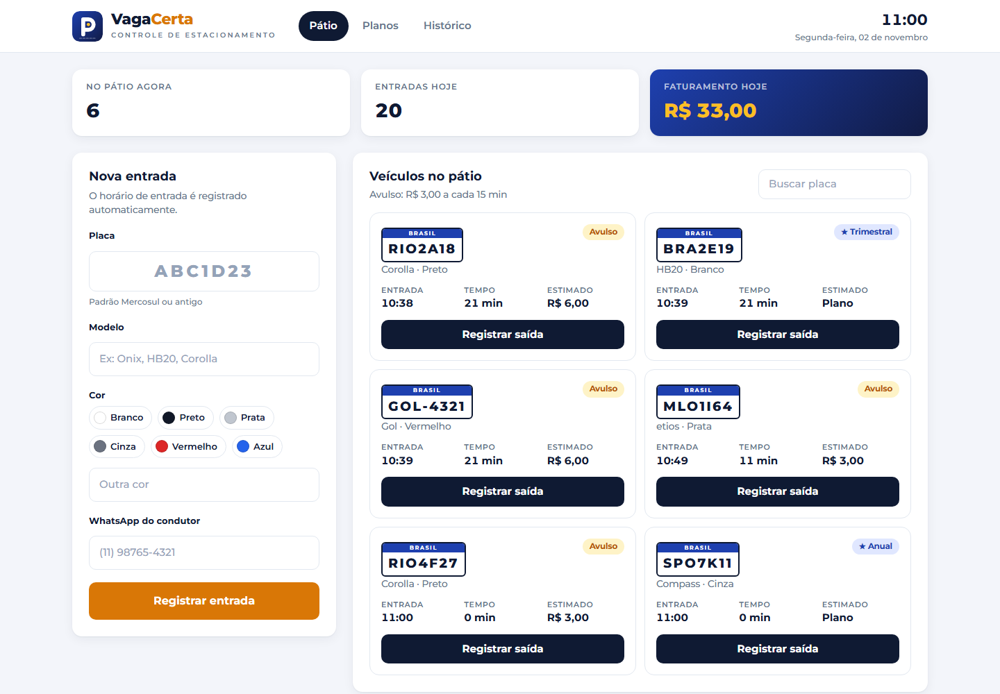
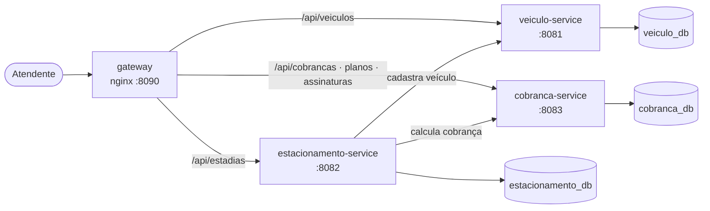

<p align="center">
  
</p>

<h1 align="center">VagaCerta · Controle de Estacionamento</h1>

<p align="center">
  Microserviços em Java 21 + Spring Boot 4 · PostgreSQL · nginx · Docker Compose
</p>

<p align="center">
  <a href="https://github.com/CarlosAlvesSantosJr/VagaCerta-gestao-estacionamento/actions/workflows/ci.yml">
    
  </a>
</p>

O atendente registra a entrada do veículo (placa, modelo, cor e WhatsApp do condutor) e o sistema anota o **horário de entrada sozinho**. Na saída, cobra **frações de 15 minutos** de quem é cliente esporádico. Quem tem plano **mensal, trimestral, semestral ou anual** em vigor não paga a permanência. O recibo pode ser enviado ao WhatsApp do condutor com um clique.



## Arquitetura



| Serviço | Responsabilidade |
|---|---|
| **[veiculo-service](veiculo-service/README.md)** | Cadastro de veículos e contato do condutor |
| **[estacionamento-service](estacionamento-service/README.md)** | Entrada e saída (tickets); orquestra os demais serviços |
| **[cobranca-service](cobranca-service/README.md)** | Tarifa avulsa, planos e assinaturas; cálculo da cobrança |
| **gateway** | Serve a interface web e roteia a API |

📘 **Documentação completa** com UML (casos de uso, componentes, classes, sequência, estados, implantação), modelo de dados, regras de negócio, API e decisões de arquitetura: **[docs/DOCUMENTACAO.md](docs/DOCUMENTACAO.md)**

## Preços

| Modalidade | Valor |
|---|---|
| Avulso | R$ 3,00 a cada 15 minutos iniciados (mínimo 1 fração) |
| Mensal | R$ 250,00 |
| Trimestral | R$ 690,00 (R$ 230,00/mês) |
| Semestral | R$ 1.300,00 (R$ 216,67/mês) |
| Anual | R$ 2.400,00 (R$ 200,00/mês) |

Os preços dos planos podem ser alterados pela API (`PUT /api/planos/{TIPO}`). O valor da fração avulsa é definido pela variável `COBRANCA_VALOR_FRACAO`.

## Como executar

Pré-requisito: **Docker Desktop**.

```bash
docker compose up -d --build
```

Acesse **http://localhost:8090**.

| Recurso | Endereço |
|---|---|
| Aplicação | http://localhost:8090 |
| API | http://localhost:8090/api |
| PostgreSQL | `localhost:5433` (usuário `postgres`, senha `root`) |

## Testes

```bash
# 76 testes unitários: rodam no build de cada imagem e no GitHub Actions
./scripts/testes-unitarios.sh

# 109 verificações de ponta a ponta na stack rodando
./testes/e2e.sh
```

A suíte de ponta a ponta cobre todas as funcionalidades, validações, planos e a resiliência quando um serviço cai. Detalhes na [seção de testes da documentação](docs/DOCUMENTACAO.md#10-testes).

## Funcionalidades

- Entrada com horário automático e bloqueio de placa duplicada no pátio
- Pátio com tempo decorrido, valor estimado e selo de mensalista
- Prévia da cobrança antes de confirmar a saída
- Cobrança avulsa por fração de 15 minutos
- Planos mensal, trimestral, semestral e anual, com renovação antecipada sem perda de dias
- Isenção automática para placas com plano vigente
- Cancelamento de plano e alteração de preços
- Recibo enviado pelo WhatsApp
- Histórico de saídas e indicadores do dia
- Interface responsiva com a identidade visual VagaCerta
- Erros padronizados (RFC 7807) e falha rápida (503) quando um serviço está fora do ar

## Contribuindo

Fluxo de trabalho, padrão de commits e convenções de código: [CONTRIBUTING.md](CONTRIBUTING.md).
