# VagaCerta · Documentação técnica

Sistema de controle de estacionamento em arquitetura de **microserviços**. Ele registra a entrada e a saída de veículos, cobra clientes esporádicos por fração de 15 minutos e gerencia planos mensal, trimestral, semestral e anual.

## Sumário

1. [Visão geral](#1-visão-geral)
2. [Funcionalidades](#2-funcionalidades)
3. [Regras de negócio](#3-regras-de-negócio)
4. [Arquitetura](#4-arquitetura)
5. [Diagramas UML](#5-diagramas-uml)
   - [Casos de uso](#51-casos-de-uso)
   - [Componentes](#52-componentes)
   - [Classes](#53-classes)
   - [Sequência](#54-sequência)
   - [Estados](#55-estados)
   - [Implantação](#56-implantação)
6. [Modelo de dados](#6-modelo-de-dados)
7. [Referência da API](#7-referência-da-api)
8. [Tratamento de erros](#8-tratamento-de-erros)
9. [Interface do usuário](#9-interface-do-usuário)
10. [Testes](#10-testes)
11. [Execução e configuração](#11-execução-e-configuração)
12. [Estrutura do repositório](#12-estrutura-do-repositório)
13. [Decisões de arquitetura](#13-decisões-de-arquitetura)
14. [Limitações conhecidas e próximos passos](#14-limitações-conhecidas-e-próximos-passos)

---

## 1. Visão geral

| Item | Descrição |
|---|---|
| **Usuário principal** | Atendente do estacionamento |
| **Problema** | Registrar entradas e saídas, calcular a cobrança sem erro manual e controlar clientes com plano |
| **Stack** | Java 21, Spring Boot 4.0, Spring Data JPA, PostgreSQL 16, nginx, HTML/CSS/JS sem framework, Docker Compose |
| **Estilo** | Microserviços com banco de dados por serviço, comunicação síncrona REST e API Gateway |

Fluxo resumido do atendimento:

1. O veículo chega e o atendente informa **placa, modelo, cor e WhatsApp do condutor**.
2. O sistema registra o **horário de entrada** pelo próprio relógio do servidor.
3. Na saída, o sistema mostra uma **prévia** do valor. O atendente confirma.
4. Se a placa tem **plano vigente**, não há cobrança. Caso contrário, cobra **R$ 3,00 por fração de 15 minutos iniciada**.
5. O recibo pode ser enviado ao **WhatsApp** do condutor com um clique.

---

## 2. Funcionalidades

### 2.1 Pátio (entrada e saída)

| # | Funcionalidade | Serviço |
|---|---|---|
| F01 | Registrar entrada com placa, modelo, cor e WhatsApp | estacionamento → veiculo |
| F02 | Capturar automaticamente o horário de entrada (servidor, fuso America/Sao_Paulo) | estacionamento |
| F03 | Impedir duas entradas abertas para a mesma placa | estacionamento |
| F04 | Listar veículos no pátio, com tempo decorrido e valor estimado | estacionamento + frontend |
| F05 | Prévia de saída: quanto custaria sair agora, sem fechar o ticket | estacionamento → cobranca |
| F06 | Registrar saída: captura o horário, calcula e grava a cobrança | estacionamento → cobranca |
| F07 | Recibo com envio pelo WhatsApp (link `wa.me` com texto pronto) | frontend |
| F08 | Histórico das últimas 50 saídas | estacionamento |
| F09 | Indicadores do dia: veículos no pátio, entradas e faturamento | estacionamento |

### 2.2 Veículos

| # | Funcionalidade | Serviço |
|---|---|---|
| F10 | Cadastro automático do veículo na primeira entrada | veiculo |
| F11 | Atualização de modelo, cor e WhatsApp quando a placa volta | veiculo |
| F12 | Normalização: placa maiúscula sem hífen; WhatsApp somente dígitos | veiculo |
| F13 | Validação de placa nos padrões antigo (ABC-1234) e Mercosul (ABC1D23) | veiculo |
| F14 | CRUD completo e busca por placa | veiculo |

### 2.3 Cobrança, planos e assinaturas

| # | Funcionalidade | Serviço |
|---|---|---|
| F15 | Cálculo avulso por fração de 15 min iniciada, com mínimo de 1 fração | cobranca |
| F16 | Tabela de planos: Mensal, Trimestral, Semestral, Anual | cobranca |
| F17 | Contratar plano para uma placa | cobranca |
| F18 | Renovação antecipada sem perda de dias | cobranca |
| F19 | Isenção na saída para placa com plano vigente | cobranca |
| F20 | Cancelar assinatura (vigente ou agendada) | cobranca |
| F21 | Alterar preço de um plano sem afetar assinaturas já pagas | cobranca |
| F22 | Consultar o plano vigente de uma placa | cobranca |

### 2.4 Não funcionais

| # | Requisito | Como é atendido |
|---|---|---|
| NF01 | Isolamento de dados | Um banco PostgreSQL por serviço |
| NF02 | Falha rápida quando um serviço cai | Timeout de 2 s (conexão) e 5 s (leitura) nas chamadas entre serviços; resposta 503 com mensagem clara |
| NF03 | Recuperação automática | O gateway resolve o DNS a cada requisição, então um serviço reiniciado com outro IP é reencontrado |
| NF04 | Horário confiável | O horário vem sempre do servidor (`Clock` injetável), nunca do cliente |
| NF05 | Erros padronizados | RFC 7807 (`ProblemDetail`) em todos os serviços |
| NF06 | Interface responsiva e acessível | Layout fluido até 360 px, rótulos em todos os campos, foco visível, `aria-live` nos avisos, suporte a `prefers-reduced-motion` |
| NF07 | Inicialização ordenada | `depends_on` com `healthcheck` (actuator `/health`) no Docker Compose |

---

## 3. Regras de negócio

### RN01 · Cobrança avulsa por fração

```
segundos  = saída − entrada
fração    = 15 min (900 s)
frações   = max(1, ⌈segundos / 900⌉)
valor     = frações × R$ 3,00
```

| Permanência | Frações | Valor |
|---|---|---|
| 0 a 15 min 00 s | 1 | R$ 3,00 |
| 15 min 01 s | 2 | R$ 6,00 |
| 1 h | 4 | R$ 12,00 |
| 1 h 01 min | 5 | R$ 15,00 |
| 8 h | 32 | R$ 96,00 |

- Saída anterior à entrada é recusada.
- O valor da fração é configurável (`COBRANCA_VALOR_FRACAO`).

### RN02 · Vigência dos planos

| Plano | Meses | Preço inicial | Equivalente mensal | Economia |
|---|---|---|---|---|
| Mensal | 1 | R$ 250,00 | R$ 250,00 | – |
| Trimestral | 3 | R$ 690,00 | R$ 230,00 | 8% |
| Semestral | 6 | R$ 1.300,00 | R$ 216,67 | 13% |
| Anual | 12 | R$ 2.400,00 | R$ 200,00 | 20% |

- **Início:** data da contratação.
- **Fim:** `início + N meses − 1 dia`, inclusive. Exemplo: mensal contratado em 02/11 vale até 01/12.
- **Renovação antecipada:** se a placa já tem um plano não cancelado que termina hoje ou depois, o novo começa no **dia seguinte ao fim** do atual.
- O preço é copiado para a assinatura (`valorPago`), então mudar a tabela não altera contratos existentes.

### RN03 · Isenção na saída

Uma placa com assinatura **não cancelada** cuja vigência inclui a **data da saída** paga **R$ 0,00**, e a estadia é marcada como `PLANO`. Fora disso, a cobrança é `AVULSO`.

### RN04 · Entrada

- A placa não pode ter outra estadia `ABERTA`.
- O veículo é criado no cadastro, ou atualizado se a placa já existir.
- A estadia guarda uma **cópia** de placa, modelo, cor e WhatsApp do momento da entrada, para que o histórico não mude se o cadastro for alterado depois.

### RN05 · Saída

- Só estadias `ABERTA` podem receber prévia ou saída.
- A saída grava horário, tipo de cobrança, plano, minutos, frações e valor, e passa o status para `FINALIZADA`.

### RN06 · Validações de dados

| Campo | Regra |
|---|---|
| Placa | `^[A-Z]{3}-?[0-9][A-Z0-9][0-9]{2}$` (maiúsculas ou minúsculas) |
| WhatsApp | 10 a 13 dígitos após remover a formatação (DDD + número, com DDI 55 opcional) |
| Modelo, cor, nome do cliente | Obrigatórios |
| Valor do plano | Maior que zero |

---

## 4. Arquitetura

### 4.1 Visão de contêineres

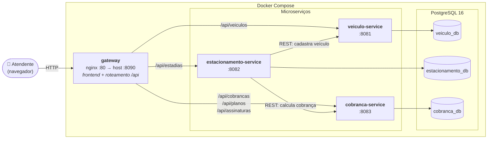

### 4.2 Responsabilidades (bounded contexts)

| Serviço | Contexto | Dono dos dados | Depende de |
|---|---|---|---|
| **veiculo-service** | Cadastro | `veiculo` | — |
| **estacionamento-service** | Operação do pátio (orquestrador) | `estadia` | veiculo, cobranca |
| **cobranca-service** | Preço e contratos | `plano`, `assinatura` | — |
| **gateway** | Borda | — | todos |

### 4.3 Camadas internas de cada serviço

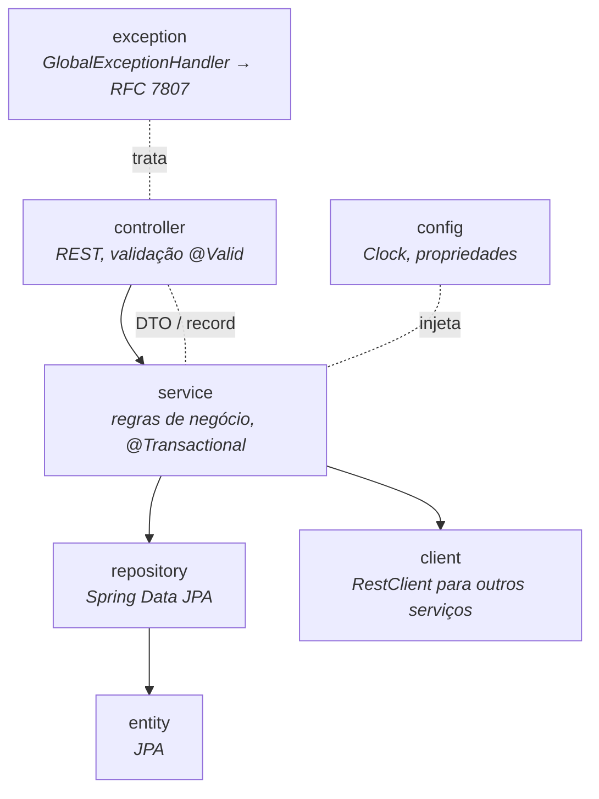

### 4.4 Roteamento do gateway

| Prefixo público | Destino interno |
|---|---|
| `/` | Arquivos estáticos (`index.html`, `css/`, `js/`, `img/`) |
| `/api/veiculos/**` | `veiculo-service:8081/veiculos/**` |
| `/api/estadias/**` | `estacionamento-service:8082/estadias/**` |
| `/api/cobrancas/**`, `/api/planos/**`, `/api/assinaturas/**` | `cobranca-service:8083/...` |

O nginx usa `resolver 127.0.0.11` (DNS do Docker) com os endereços em variáveis. Assim o nome é resolvido de novo a cada requisição e o gateway sobrevive ao reinício de um serviço.

---

## 5. Diagramas UML

### 5.1 Casos de uso

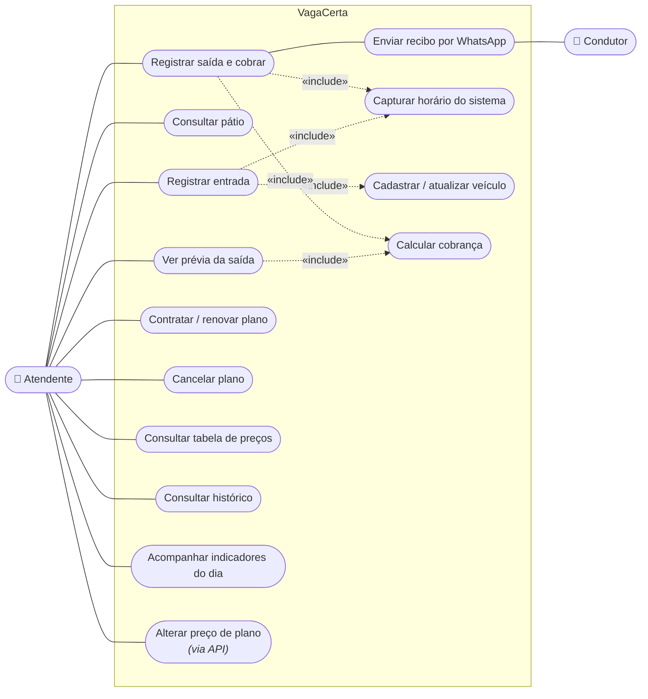

### 5.2 Componentes

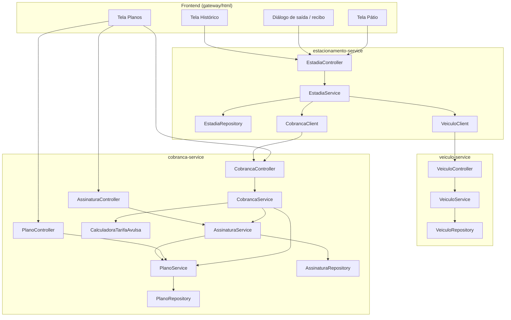

### 5.3 Classes

#### veiculo-service

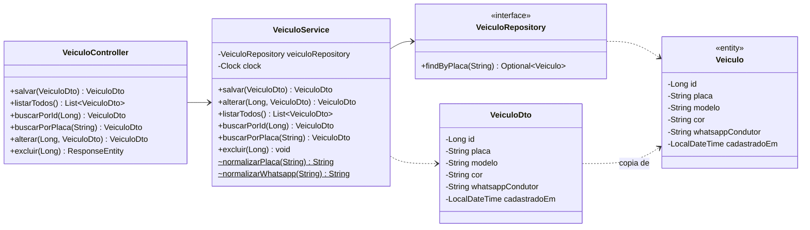

#### estacionamento-service

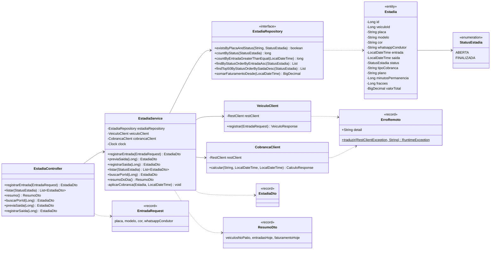

#### cobranca-service

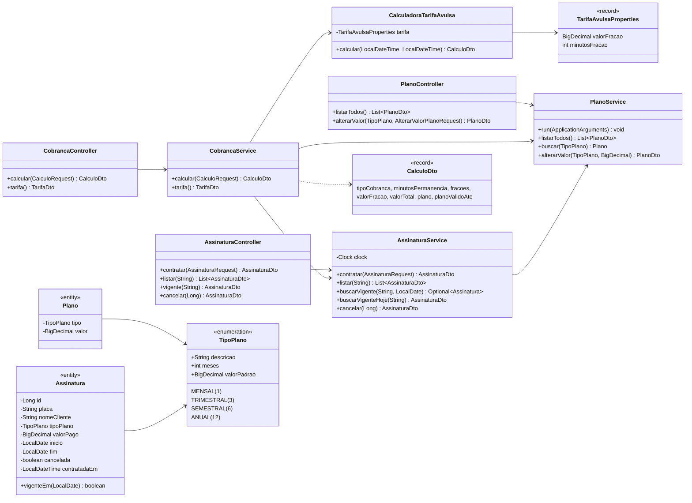

### 5.4 Sequência

#### Registrar entrada

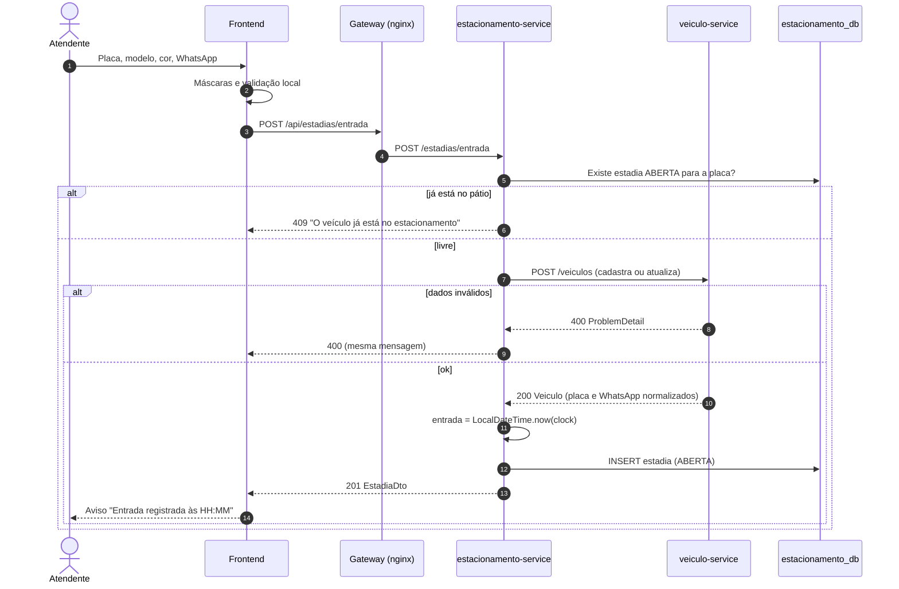

#### Prévia e registro de saída

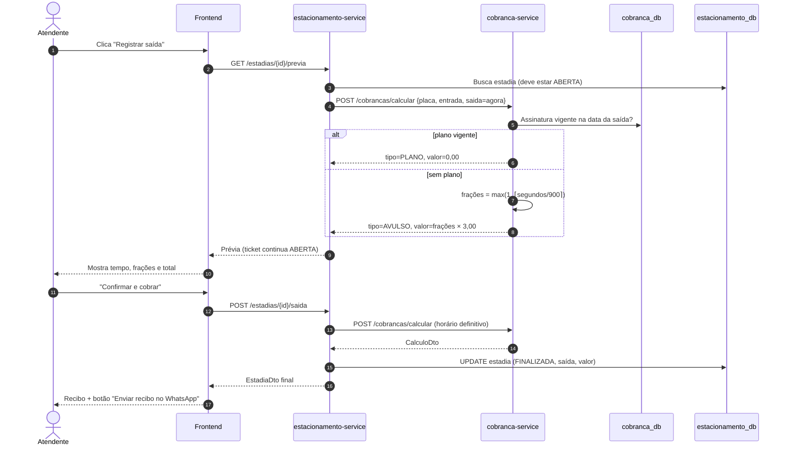

#### Contratar ou renovar plano

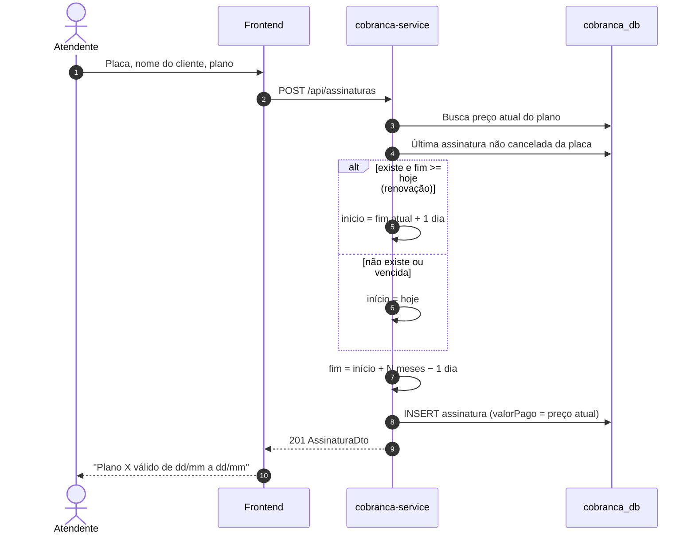

#### Falha de um serviço dependente

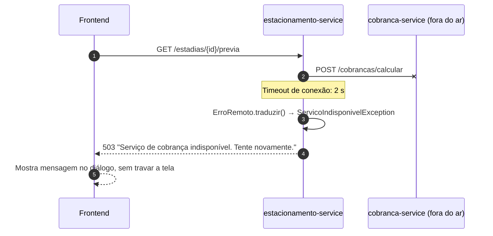

### 5.5 Estados

#### Estadia (ticket)

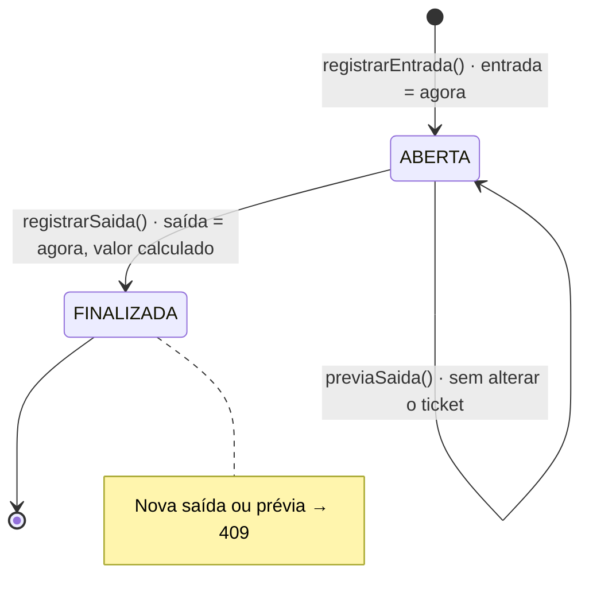

#### Assinatura

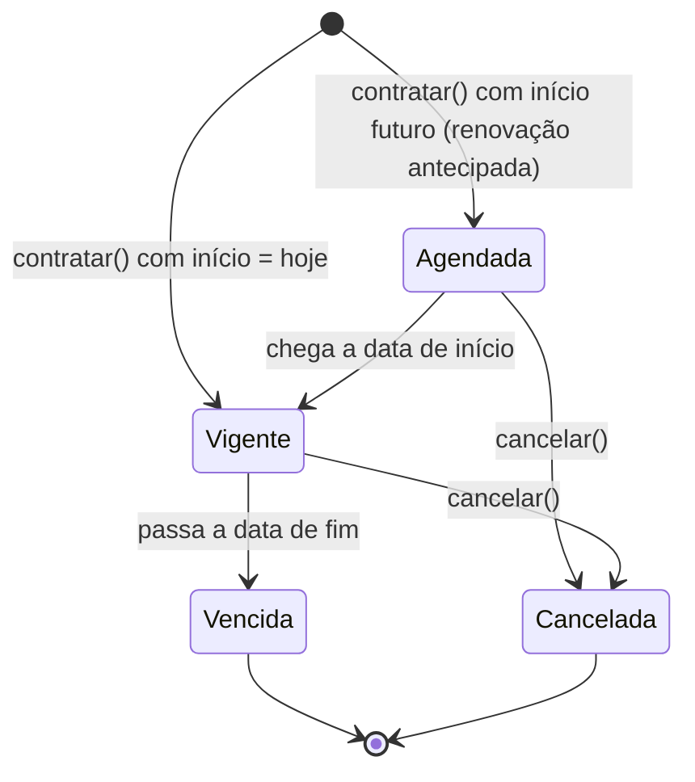

> Os estados "Agendada", "Vigente" e "Vencida" são derivados das datas (`inicio`, `fim`) e do dia atual. No banco existe apenas o flag `cancelada`.

### 5.6 Implantação

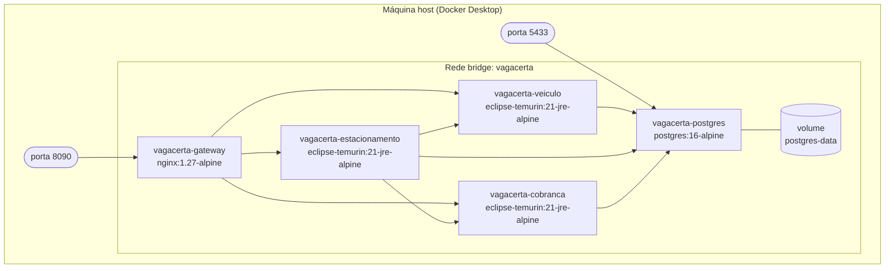

Ordem de inicialização garantida por `healthcheck`: **postgres → veiculo + cobranca → estacionamento → gateway**.

---

## 6. Modelo de dados

Cada serviço tem o seu banco. Não há chave estrangeira entre bancos: a estadia guarda `veiculo_id` e uma cópia dos dados do veículo.

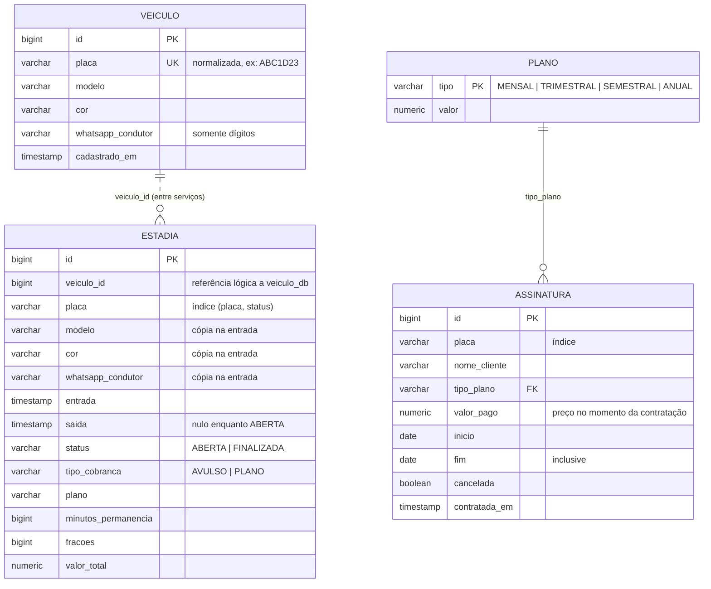

| Banco | Tabelas | Serviço dono |
|---|---|---|
| `veiculo_db` | `veiculo` | veiculo-service |
| `estacionamento_db` | `estadia` | estacionamento-service |
| `cobranca_db` | `plano`, `assinatura` | cobranca-service |

O esquema é criado pelo Hibernate (`ddl-auto=update`). Os quatro planos são inseridos na primeira subida pelo `PlanoService`, que implementa `ApplicationRunner`.

---

## 7. Referência da API

Base pública: `http://localhost:8090/api`. Todas as requisições e respostas usam JSON UTF-8. Datas seguem a ISO-8601 (`2026-11-02T10:38:30`, sem fuso, horário de Brasília).

### 7.1 Estadias (estacionamento-service)

| Método | Rota | Corpo | Sucesso | Erros |
|---|---|---|---|---|
| POST | `/estadias/entrada` | `EntradaRequest` | 201 `EstadiaDto` | 400, 409, 503 |
| GET | `/estadias?status=ABERTA` | — | 200 `EstadiaDto[]` (pátio, mais antigos primeiro) | 400 |
| GET | `/estadias?status=FINALIZADA` | — | 200 `EstadiaDto[]` (50 últimas saídas) | 400 |
| GET | `/estadias/{id}` | — | 200 `EstadiaDto` | 404 |
| GET | `/estadias/{id}/previa` | — | 200 `EstadiaDto` com valores calculados | 404, 409, 503 |
| POST | `/estadias/{id}/saida` | — | 200 `EstadiaDto` finalizada | 404, 409, 503 |
| GET | `/estadias/resumo` | — | 200 `ResumoDto` | — |

**Exemplo: entrada**

```http
POST /api/estadias/entrada
Content-Type: application/json

{ "placa": "abc-1d23", "modelo": "Onix", "cor": "Prata", "whatsappCondutor": "(11) 98765-4321" }
```

```json
{
  "id": 1, "veiculoId": 1, "placa": "ABC1D23", "modelo": "Onix", "cor": "Prata",
  "whatsappCondutor": "11987654321", "entrada": "2026-11-02T10:38:30", "saida": null,
  "status": "ABERTA", "tipoCobranca": null, "plano": null,
  "minutosPermanencia": null, "fracoes": null, "valorTotal": null
}
```

**Exemplo: saída de um mensalista**

```json
{
  "id": 2, "placa": "BRA2E19", "entrada": "2026-11-02T10:38:33", "saida": "2026-11-02T12:10:05",
  "status": "FINALIZADA", "tipoCobranca": "PLANO", "plano": "TRIMESTRAL",
  "minutosPermanencia": 91, "fracoes": 7, "valorTotal": 0.00
}
```

**Resumo do dia**

```json
{ "veiculosNoPatio": 6, "entradasHoje": 20, "faturamentoHoje": 33.00 }
```

### 7.2 Veículos (veiculo-service)

| Método | Rota | Corpo | Sucesso | Erros |
|---|---|---|---|---|
| POST | `/veiculos` | `VeiculoDto` | 200 (cria ou atualiza pela placa) | 400 |
| GET | `/veiculos` | — | 200 `VeiculoDto[]` | — |
| GET | `/veiculos/{id}` | — | 200 | 404 |
| GET | `/veiculos/placa/{placa}` | — | 200 | 404 |
| PUT | `/veiculos/{id}` | `VeiculoDto` | 200 | 400 (placa de outro veículo), 404 |
| DELETE | `/veiculos/{id}` | — | 204 | 404 |

### 7.3 Cobrança, planos e assinaturas (cobranca-service)

| Método | Rota | Corpo | Sucesso | Erros |
|---|---|---|---|---|
| GET | `/cobrancas/tarifa` | — | 200 `TarifaDto` | — |
| POST | `/cobrancas/calcular` | `{placa, entrada, saida}` | 200 `CalculoDto` | 400 |
| GET | `/planos` | — | 200 `PlanoDto[]` | — |
| PUT | `/planos/{TIPO}` | `{"valor": 260.00}` | 200 `PlanoDto` | 400 |
| POST | `/assinaturas` | `{placa, nomeCliente, tipoPlano}` | 201 `AssinaturaDto` | 400, 404 |
| GET | `/assinaturas?placa=` | — | 200 `AssinaturaDto[]` | — |
| GET | `/assinaturas/vigente/{placa}` | — | 200 `AssinaturaDto` | 404 |
| DELETE | `/assinaturas/{id}` | — | 200 `AssinaturaDto` (cancelada) | 400, 404 |

**Exemplo: tarifa**

```json
{
  "valorFracao": 3.00, "minutosFracao": 15,
  "planos": [
    { "tipo": "MENSAL", "descricao": "Mensal", "meses": 1, "valor": 250.00 },
    { "tipo": "TRIMESTRAL", "descricao": "Trimestral", "meses": 3, "valor": 690.00 },
    { "tipo": "SEMESTRAL", "descricao": "Semestral", "meses": 6, "valor": 1300.00 },
    { "tipo": "ANUAL", "descricao": "Anual", "meses": 12, "valor": 2400.00 }
  ]
}
```

**Exemplo: assinatura**

```json
{
  "id": 1, "placa": "BRA2E19", "nomeCliente": "Maria Souza",
  "tipoPlano": "TRIMESTRAL", "descricaoPlano": "Trimestral", "valorPago": 690.00,
  "inicio": "2026-11-02", "fim": "2027-02-01", "cancelada": false, "vigente": true,
  "contratadaEm": "2026-11-02T10:38:33"
}
```

---

## 8. Tratamento de erros

Todos os serviços respondem erros no formato **RFC 7807** (`ProblemDetail`). O campo `detail` traz uma mensagem pronta para exibir ao usuário:

```json
{ "type": "about:blank", "title": "Conflict", "status": 409,
  "detail": "O veículo ABC1D23 já está no estacionamento", "instance": "/estadias/entrada" }
```

| Status | Quando | Exceção |
|---|---|---|
| 400 | Validação de campo, regra de negócio, JSON malformado, parâmetro inválido na URL | `MethodArgumentNotValidException`, `RegraNegocioException`, `HttpMessageNotReadableException`, `MethodArgumentTypeMismatchException` |
| 404 | Recurso não encontrado | `RecursoNaoEncontradoException` |
| 409 | Placa já no pátio; saída ou prévia de ticket finalizado | `ConflitoException` |
| 503 | veiculo-service ou cobranca-service fora do ar ou lento | `ServicoIndisponivelException` |

**Propagação entre serviços:** os clientes HTTP do estacionamento-service traduzem as respostas por meio de `ErroRemoto.traduzir()`:
- um **4xx** do serviço remoto vira `RegraNegocioException`, preservando a mensagem original (por exemplo, "Placa inválida");
- timeout, recusa de conexão ou **5xx** viram `ServicoIndisponivelException` (503).

Timeouts: **2 s** para conectar e **5 s** para ler a resposta.

---

## 9. Interface do usuário

Identidade visual **VagaCerta**:

| Token | Cor | Uso |
|---|---|---|
| Azul da marca → azul escuro | `#1E40AF → #111B45` | Degradê do ícone, card de faturamento, topo do recibo |
| Marinho | `#0F1A33` | Texto, aba ativa, botões secundários escuros |
| Laranja | `#D97706` | Ação principal, destaque "Certa", total do recibo |
| Amarelo | `#FBBF24` | Ponto do "P", valor do faturamento |
| Ardósia | `#64748B` | Textos de apoio e rótulos |

Tipografia: **Montserrat**, de 500 a 800.

### Telas

| Pátio | Planos |
|---|---|
| 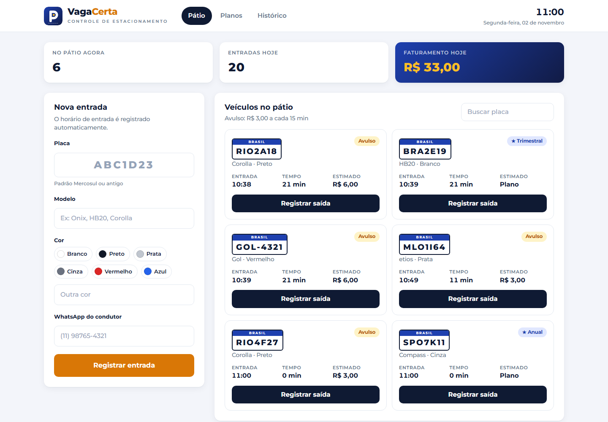 | 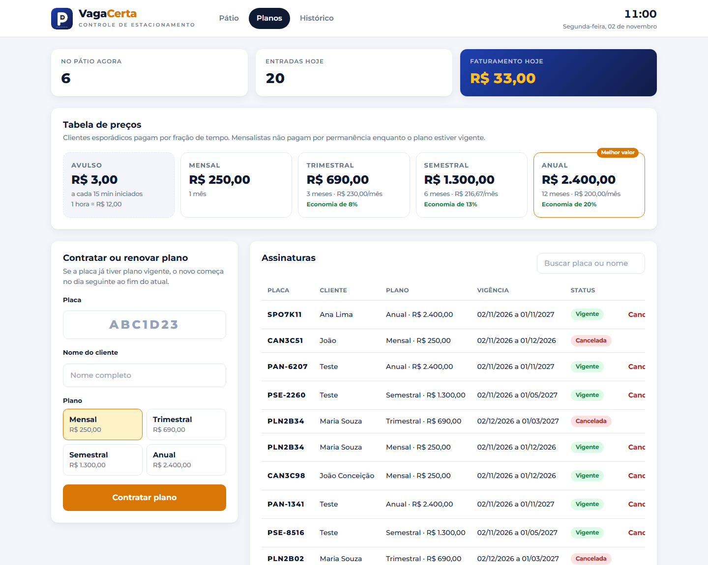 |

| Histórico | Celular |
|---|---|
| 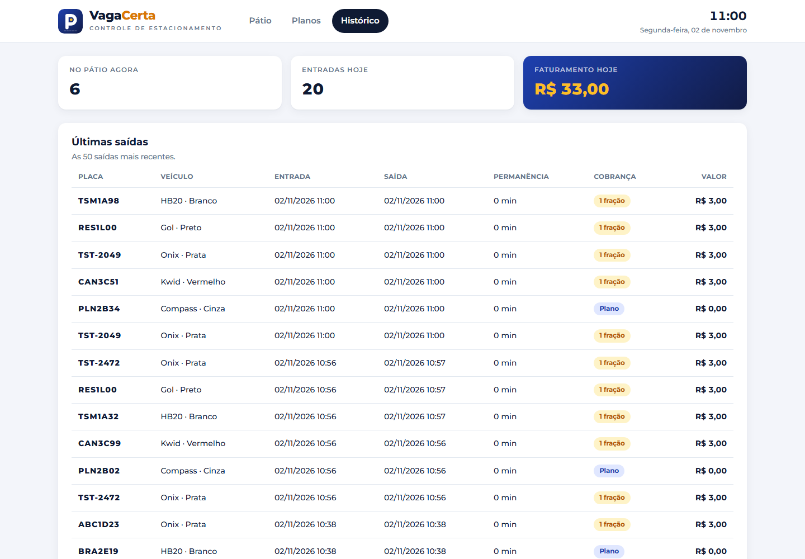 | 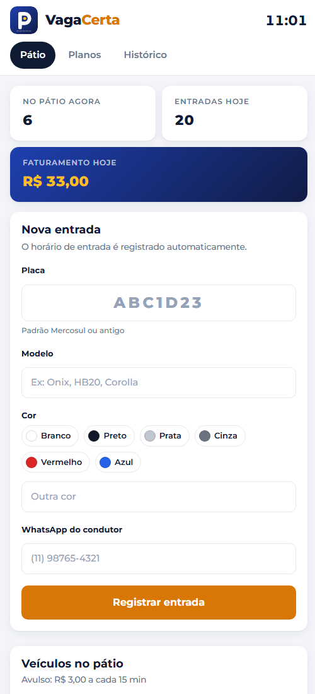 |

### Decisões de UX

- **Fluxo principal em uma tela:** formulário de entrada e pátio lado a lado, sem troca de página no balcão.
- **Horário automático explícito:** o formulário avisa que a entrada é registrada pelo sistema, então não existe campo de hora para errar.
- **Placa em destaque:** o campo é grande, em maiúsculas, aceita digitação com ou sem hífen e vira uma placa Mercosul nos cartões.
- **Cor com um toque:** botões para as seis cores mais comuns, mais um campo livre para as demais.
- **Máscara de WhatsApp:** `(11) 98765-4321` enquanto o atendente digita.
- **Saída em duas etapas:** a prévia mostra tempo, frações e total antes de confirmar, o que evita cobrança errada por clique acidental.
- **Mensalista identificado:** selo "★ Plano" no cartão do pátio e "Plano" no lugar do valor estimado.
- **Recibo por WhatsApp:** link `wa.me` com o recibo já escrito.
- **Feedback imediato:** avisos (`aria-live`), botões com estado "Registrando…", erros do servidor exibidos no próprio formulário.
- **Tabela de preços comparativa:** mostra o equivalente mensal e a economia de cada plano, com "Melhor valor" no anual.
- **Atualização automática:** pátio e indicadores se atualizam a cada 30 s, e o tempo decorrido é recalculado.
- **Acessibilidade:** rótulos em todos os campos, `role="radiogroup"` nas escolhas, foco visível em laranja, `Esc` fecha o diálogo, animações desligadas com `prefers-reduced-motion`.

---

## 10. Testes

### 10.1 Unitários (JUnit 5 + Mockito + AssertJ)

Rodam em todo `docker compose build` (fase `mvn package`). Se algum teste falhar, a imagem não é gerada.

| Serviço | Classe | Testes | O que cobre |
|---|---|---|---|
| veiculo | `VeiculoServiceTest` | 3 | Normalização de placa e WhatsApp, horário de cadastro, atualização por placa existente, rejeição de WhatsApp sem DDD |
| cobranca | `CalculadoraTarifaAvulsaTest` | 8 | 0 s, 10 min, 15 min, 15 min 01 s, 1 h, 1 h 01 min, 8 h; saída antes da entrada |
| cobranca | `AssinaturaServiceTest` | 3 | Vigência dos 4 planos, renovação emendada, plano vencido não emenda |
| cobranca | `CobrancaServiceTest` | 2 | Avulso cobra por fração; placa com plano paga zero |
| estacionamento | `EstadiaServiceTest` | 5 | Horário do sistema na entrada, placa duplicada, saída com valor da cobrança, prévia não fecha o ticket, saída repetida |
| **Total** | | **21** | |

Para rodar só os testes de um serviço:

```bash
docker run --rm -v "$PWD/cobranca-service":/app -w /app maven:3.9.9-eclipse-temurin-21 mvn -q test
```

### 10.2 Ponta a ponta (`testes/e2e.sh`)

Script bash que exercita a **stack real** pelo gateway: **109 verificações** em 12 grupos.

| Grupo | Verificações |
|---|---|
| Gateway e frontend | Arquivos estáticos e marca |
| Tarifa e planos | Fração de 15 min, R$ 3,00, 4 planos |
| Entrada | 201, normalização, horário automático, placa Mercosul, DDI 55 |
| Regras de entrada | 409 duplicada, 400 placa, 400 WhatsApp, 400 vazios, 400 JSON malformado |
| Veículos | Cadastro automático, busca por placa, CRUD, placa de outro veículo |
| Pátio e saída | Prévia, saída, valores, 409 repetida, 404 inexistente, reentrada |
| Planos | Vigência dos 4 planos, renovação, validações, consulta vigente |
| Mensalista | Prévia e saída com R$ 0,00 |
| Cancelamento | Cancelar, nome com acento, cancelar de novo, volta a pagar avulso |
| Preço de plano | Alterar, refletir na tarifa, recusar zero/tipo inexistente, preservar valor pago |
| Histórico e resumo | Listagem, filtro inválido, indicadores |
| Resiliência | Derruba o cobranca-service: 503 em menos de 4 s, entrada continua funcionando, gateway se recupera |

```bash
docker compose up -d --build
./testes/e2e.sh
# ✔ 109 de 109 verificações passaram
```

Opções: `BASE=http://host:porta` para outro endereço e `PULAR_RESILIENCIA=1` para não derrubar serviços.

---

## 11. Execução e configuração

### Pré-requisitos

- Docker Desktop (ou Docker Engine com Compose v2)
- Portas livres: **8090** (aplicação) e **5433** (PostgreSQL)

### Subir

```bash
docker compose up -d --build
```

Acesse **http://localhost:8090**.

### Comandos úteis

```bash
docker compose ps                         # estado e saúde dos contêineres
docker compose logs -f estacionamento-service
docker compose restart cobranca-service
docker compose down                       # para (mantém os dados)
docker compose down -v                    # para e apaga o banco
```

### Variáveis de ambiente

| Variável | Serviço | Padrão | Descrição |
|---|---|---|---|
| `SPRING_DATASOURCE_URL` | todos | `jdbc:postgresql://localhost:5432/<serviço>_db` | Conexão com o banco |
| `SPRING_DATASOURCE_USERNAME` / `PASSWORD` | todos | `postgres` / `root` | Credenciais |
| `COBRANCA_VALOR_FRACAO` | cobranca | `3.00` | Valor de cada fração avulsa |
| `SERVICOS_VEICULO_URL` | estacionamento | `http://localhost:8081` | Endereço do veiculo-service |
| `SERVICOS_COBRANCA_URL` | estacionamento | `http://localhost:8083` | Endereço do cobranca-service |
| `TZ` | todos | `America/Sao_Paulo` | Fuso do contêiner |

Propriedade `estacionamento.fuso-horario` (padrão `America/Sao_Paulo`): fuso do `Clock` usado em todos os horários de negócio.

### Rodar um serviço fora do Docker

Com o Postgres do Compose no ar (porta 5433):

```bash
cd cobranca-service
SPRING_DATASOURCE_URL=jdbc:postgresql://localhost:5433/cobranca_db mvn spring-boot:run   # requer JDK 21 e Maven
```

---

## 12. Estrutura do repositório

```
.
├── docker-compose.yml           # orquestração da stack
├── postgres/init.sql            # cria um banco por serviço
├── gateway/
│   ├── Dockerfile
│   ├── nginx.conf               # roteamento /api e DNS dinâmico
│   └── html/                    # frontend (index.html, css/, js/, img/)
├── veiculo-service/
│   └── src/main/java/controle_estacionamento/veiculo/
│       ├── controller/  dto/  entity/  repository/  service/  exception/  config/
├── estacionamento-service/
│   └── src/main/java/controle_estacionamento/estacionamento/
│       ├── controller/  dto/  entity/  repository/  service/  client/  exception/  config/
├── cobranca-service/
│   └── src/main/java/controle_estacionamento/cobranca/
│       ├── controller/  dto/  entity/  repository/  service/  exception/  config/
├── testes/e2e.sh                # testes de ponta a ponta
└── docs/
    ├── DOCUMENTACAO.md          # este documento
    └── img/                     # capturas de tela
```

---

## 13. Decisões de arquitetura

| # | Decisão | Motivo | Alternativa descartada |
|---|---|---|---|
| D1 | **Três serviços** separados por contexto: cadastro, operação e preço | Preço e planos mudam por motivos comerciais; a operação do pátio muda por motivos operacionais. Cada um evolui e escala separadamente | Um serviço por entidade (granularidade excessiva) |
| D2 | **Banco por serviço** em um único contêiner PostgreSQL | Isolamento de dados com custo operacional baixo para o porte do projeto | Uma instância de Postgres por serviço |
| D3 | **estacionamento-service como orquestrador** com REST síncrono | O atendente precisa da resposta na hora (valor, conflito) | Mensageria assíncrona (complexidade sem ganho para o fluxo de balcão) |
| D4 | **Snapshot dos dados do veículo** na estadia | O histórico fica correto mesmo se o cadastro mudar, e o pátio não depende do veiculo-service para listar | Consultar o veiculo-service a cada listagem |
| D5 | **Horário via `Clock` injetado** | O horário vem do servidor (exigência de negócio) e os testes podem usar relógio fixo | `LocalDateTime.now()` direto |
| D6 | **Cálculo de cobrança só no cobranca-service** | Regra de preço em um único lugar; o frontend só *estima* para exibição | Calcular no estacionamento-service |
| D7 | **Assinatura guarda `valorPago`** | Reajuste de tabela não altera contratos já pagos | Ler sempre o preço atual |
| D8 | **nginx como gateway** | Simples, leve e também serve o frontend | Spring Cloud Gateway (mais memória e mais acoplamento de versão) |
| D9 | **Frontend sem framework** | Nenhum build, carrega instantaneamente e é fácil de manter para o escopo | React ou Angular |
| D10 | **Timeouts + 503 em vez de circuit breaker** | Resolve o problema real (tela travada) com o mínimo de dependências | Resilience4j |

---

## 14. Limitações conhecidas e próximos passos

| Item | Situação atual | Sugestão |
|---|---|---|
| Autenticação | Não há login; qualquer um com acesso à rede usa o sistema | Spring Security + JWT no gateway, com perfis atendente/gerente |
| Concorrência na entrada | Duas entradas simultâneas da mesma placa podem passar pela checagem | Índice único parcial `(placa) WHERE status = 'ABERTA'` |
| Consistência entre serviços | Se a gravação da estadia falhar após o cadastro do veículo, o veículo fica cadastrado (efeito inofensivo) | Aceitável; para fluxos críticos, padrão Saga/outbox |
| Migrações de banco | `ddl-auto=update` | Flyway com scripts versionados |
| Preço avulso | Vem de propriedade (requer reinício para mudar) | Mover para tabela, como os planos |
| Mudança de plano no meio da estadia | A isenção considera a data da saída | Regra proporcional, se o negócio exigir |
| Pagamento | O sistema registra o valor, mas não integra com meios de pagamento | Integração PIX / maquininha |
| Envio de WhatsApp | Link `wa.me` aberto pelo atendente | WhatsApp Business API para envio automático |
| Credenciais | Senha do banco fixa no Compose | Docker secrets / `.env` fora do repositório |
| Observabilidade | Apenas `/actuator/health` (Prometheus e Grafana foram removidos a pedido) | Reativar se for necessário monitorar em produção |
